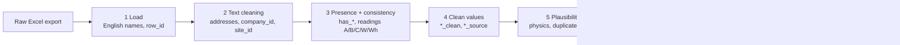

# Data quality: how the cleaning works, and what the flags and tiers mean

This document explains how the pipeline treats every row of the PfA register, what each
flag column means, why it is set, and what the quality tiers A–D stand for. The
flag and tier reference (sections 6 and 7) is generated from
`src/pfa_wasteheat/definitions.py`, so it always matches the code.

Counts for the current data are written to `data/processed/cleaning_summary.md`
every time the pipeline runs. Numbers quoted below are from the BAFA export of
13.05.2025 (22,198 rows).

**Contents**

1. [Principle](#1-principle)
2. [The pipeline at a glance](#2-the-pipeline-at-a-glance)
3. [What happens to one row](#3-what-happens-to-one-row)
4. [From the old cases 1–16 to the new rules](#4-from-the-old-cases-116-to-the-new-rules)
5. [Where a value came from: the `*_source` columns](#5-where-a-value-came-from-the-_source-columns)
6. [Quality tiers](#6-quality-tiers)
7. [Flag reference](#7-flag-reference)
8. [Using the tiers and flags in the thesis](#8-using-the-tiers-and-flags-in-the-thesis)
9. [Fields that are derived from other fields](#9-fields-that-are-derived-from-other-fields)
10. [Ideas not implemented yet](#10-ideas-not-implemented-yet)

---

## 1. Principle

- **Nothing is deleted.** Every row of the register is still in the output, so all
  numbers in the thesis can be traced back to the original file.
- **Nothing reported is overwritten.** The raw columns stay exactly as published.
  Cleaned values go into new `*_clean` columns.
- **Every decision is visible.** Each check writes a flag column (`True`/`False`),
  and each filled-in value records where it came from. The quality tier sums this up.

Deciding which rows to use is therefore not part of cleaning. It happens in the
modelling step, where it can be varied (e.g. tiers A+B vs. A+B+C) to show that the
results do not depend on one cleaning choice.

## 2. The pipeline at a glance

| Step | Module | Adds |
|---|---|---|
| 1 | `loading.py` | English column names, `row_id`, `Original_Excel_Row`; contact columns dropped |
| 2 | `text_cleaning.py` | Normalised names and addresses, `weekend_available`, `ctrl_*`, `company_id`, `site_id` |
| 3 | `consistency.py` | `has_*`, `ratio_*`, `interp_*`, `consistency_status`, `is_flat_profile_raw`, `n_active_months` |
| 4 | `imputation.py` | `*_clean` values, `*_source`, `was_rescaled`, `scale_factor`, `was_imputed`, `peak_monthly_kw` |
| 5 | `plausibility.py` | Physical, reporting-style, duplicate and threshold flags; medium flags |
| 6 | `quality.py` | `quality_tier`, `quality_reasons` |

## 3. What happens to one row

### 3.1 Which values count as reported

Many reporters typed 0 or 1 into fields they could not fill. These placeholders are
treated as missing (limits in `config.yaml`, section `presence`):

| Column | Counts as reported when | Flag |
|---|---|---|
| Annual energy | > 1 kWh/a | `has_annual` |
| Max thermal power | > 1 kW | `has_max_power` |
| Monthly profile | at least one month > 1 kW | `has_monthly` |
| Daily availability | > 0 h | `has_daily_hours` |
| Temperature | not empty | `has_temperature` |

Change from the first version: a daily availability of 1 h now counts as a real
value (140 rows); before, ≤ 1 h was treated as missing.

### 3.2 Do annual energy and monthly profile agree?

The platform asks for monthly "power profiles in kW", but reporters filled them in
differently. For every row with both an annual value and a monthly profile, the 12
values are converted to energy under five readings, and each result is compared with
the reported annual energy:

| Reading | The reporter meant … | Annual energy = |
|---|---|---|
| **A** | kW while the source is available | Σ value × daily hours × available days |
| **B** | kW averaged over the whole month | Σ value × 24 h × days in month |
| **C** | kWh per month (energy, not power) | Σ value |
| **W** | W instead of kW, while available | Σ value / 1000 × daily hours × available days |
| **Wh** | Wh per month | Σ value / 1000 |

Available days = all days if `Weekend_Availability` is *ja*; otherwise Monday–Friday
minus nationwide public holidays (2025: 252 days).

**Worked example.** A source reports 100 in every month, 16 h/day, no weekends, and an
annual energy of 400,000 kWh:

| Reading | Recalculated | Reported / recalculated | Fits (±10 %)? |
|---|---|---|---|
| A | 100 × 16 h × 252 d = 403,200 kWh | 0.99 | yes |
| B | 100 × 8,760 h = 876,000 kWh | 0.46 | no |
| C | 12 × 100 = 1,200 kWh | 333 | no |

→ best reading A, `consistency_status = consistent_as_reported`, tier A.

How the result is chosen:

- A reading **fits** if reported / recalculated is within the tolerance (default ±10 %).
- If A or B fits, it wins (the unit is as the platform asked). A unit fix (C, W, Wh)
  is only chosen if neither A nor B fits.
- Otherwise the reading **closest** to the reported value wins (smallest log-distance).
  "First match wins" is no longer used.

`ratio_A` … `ratio_Wh` store reported / recalculated for every reading, so you can look
at the distribution yourself (the cleaning app plots it).

| `consistency_status` | Meaning | Rows (2025) |
|---|---|---|
| `consistent_as_reported` | Reading A or B fits | 10,208 |
| `consistent_after_unit_fix` | Only C, W or Wh fits | 3,421 |
| `inconsistent` | No reading fits | 8,144 |
| `not_testable` | Annual energy or monthly profile missing | 425 |

### 3.3 Building the clean values

Depending on what was reported, the clean monthly and annual energy are built by one
of these rules (`imputation.py`):

| Annual (Q) | Monthly (M) | Clean monthly energy | Clean annual energy |
|---|---|---|---|
| yes | yes, a reading fits | best reading | reported |
| yes | yes, nothing fits | shape of the closest reading, **rescaled** to Q | reported |
| no | yes | reading A (B if daily hours are missing) | sum of the months |
| yes | no | **flat**, spread over the available hours | reported |
| no | no, but max power + daily hours | **flat** at max power | sum of the months |
| no | no, otherwise | none → `no_energy_info` | none |

With `unmatched_strategy: trust_profile` in `config.yaml`, the second rule changes:
the monthly values (reading A) are kept and the annual energy is replaced by their sum.

Then:

1. The 12 monthly energies of every row are scaled to add up **exactly** to the clean
   annual energy. For rows that fit, this is a small correction within the tolerance;
   the original deviation is still in `interp_ratio`.
2. **Daily hours:** reported value, else annual / (max power × available days) if max
   power is reported (full-load hours per day), else 24 h on the available days.
3. **Max power:** reported value, else the highest monthly power while available.
4. `share_<Month>` = monthly energy / annual energy (the profile **shape**, sums to 1).

### 3.4 Checks and tier

Step 5 runs the plausibility, reporting-style, duplicate and BfEE threshold checks
(each is a flag, see the reference below). Step 6 combines them into one tier:
any tier-D flag → D; else any tier-C flag → C; else A or B by consistency status.

## 4. From the old cases 1–16 to the new rules

The first version handled each combination of the four key fields
(annual Q, max power P, daily hours D, monthly M) in its own block. The new rules
cover the same 16 combinations:

| Old case | Q | P | D | M | Old action | New handling | Rows (2025) | Tier |
|---|---|---|---|---|---|---|---|---|
| 1 | ✔ | – | – | – | deleted | flat from annual; 24 h assumed; max power derived | 4 | C |
| 2 | – | ✔ | – | ✔ | deleted | annual from months (reading B); daily hours from max power | 0 | C |
| 3 | – | – | – | – | deleted | `no_energy_info` | 14 | D |
| 4 | – | ✔ | – | – | deleted | `no_energy_info` (power without hours gives no energy) | 3 | D |
| 5 | – | – | ✔ | – | deleted | `no_energy_info` | 53 | D |
| 6 | – | – | – | ✔ | deleted | annual from months (reading B); 24 h assumed; max power derived | 1 | C |
| 7 | – | – | ✔ | ✔ | updated | annual from months (reading A); max power derived | 0 | C |
| 8 | – | ✔ | ✔ | ✔ | updated | annual from months (reading A) | 4 | C (in 2025 all 4 are D: `flh_impossible`) |
| 9 | – | ✔ | ✔ | – | updated | flat at max power | 0 | C |
| 10 | ✔ | ✔ | ✔ | ✔ | updated | consistency check of all readings | 21,030 | A / B / C |
| 11 | ✔ | ✔ | – | ✔ | updated | consistency check (B, C, Wh); daily hours from max power | 582 | C |
| 12 | ✔ | – | ✔ | ✔ | updated | consistency check; max power derived | 155 | C |
| 13 | ✔ | ✔ | ✔ | – | updated | flat from annual | 154 | C |
| 14 | ✔ | ✔ | – | – | updated | flat from annual; daily hours from max power | 13 | C |
| 15 | ✔ | – | ✔ | – | updated | flat from annual; max power derived | 179 | C |
| 16 | ✔ | – | – | ✔ | updated | consistency check (B, C, Wh); 24 h assumed; max power derived | 6 | C |
| unmatched 1–3 | | | | | W→kW, kWh→kW, Wh→kW | readings W, C, Wh in the consistency check | | B |
| unmatched 4 | | | | | scaled to annual | `was_rescaled`, `scale_factor` | 8,144 | C |
| BfEE filters | | | | | deleted | `below_*` flags | 4,883 | unchanged |

Rows in a case can still end up in tier D through other flags (e.g. temperature,
impossible full-load hours). Readings A and W need daily hours, so in cases 11 and 16
only B, C and Wh can be tested.

## 5. Where a value came from: the `*_source` columns

| Column | Value | Meaning |
|---|---|---|
| `monthly_source` | `reported:A` (B, C, W, Wh) | Reported monthly values, converted with this reading |
| | `rescaled:A` (…) | Shape of this reading, scaled to the reported annual energy |
| | `reported:A_assumed` | No annual value to check against; reading A (or B) assumed |
| | `flat_from_annual` | No monthly values; annual energy spread evenly over the available hours |
| | `flat_from_max_power` | No monthly or annual values; max power × available hours |
| | `none` | No energy information |
| `annual_source` | `reported` | Reported annual energy |
| | `from_monthly:A_assumed` | Sum of the monthly energies |
| | `from_max_power` | Max power × available hours |
| `max_power_source` | `reported` / `derived` / `none` | Derived = highest monthly power while available |
| `daily_hours_source` | `reported` | Reported daily availability |
| | `derived_from_max_power` | Annual energy / (max power × available days) |
| | `assumed_24h` | No max power either; continuous operation assumed |

`imputed_fields` lists which of the four values were filled in for a row.

<!-- GENERATED:FLAGS START - edit src/pfa_wasteheat/definitions.py, then run python -m pfa_wasteheat.definitions -->

## 6. Quality tiers

| Tier | Name | Meaning | Rule | How to use |
|---|---|---|---|---|
| **A** | Consistent as reported | Annual energy and monthly profile agree in the unit the platform asked for (kW). Nothing was filled in and nothing is physically impossible. | `consistency_status` = `consistent_as_reported` (best reading A or B within the tolerance), no tier-C flag, no tier-D flag. | The most reliable rows. Use alone for a strict check of the main results. |
| **B** | Consistent after a unit fix | Annual energy and monthly profile agree once an obvious unit mistake is corrected: monthly values given as kWh per month (C), W instead of kW (W) or Wh (Wh). | `consistency_status` = `consistent_after_unit_fix`, no tier-C flag, no tier-D flag. | As reliable as A once converted - the correction is explained by a unit, not guessed. Main analysis: A + B. |
| **C** | Usable, but corrected or completed | Annual energy and profile contradict each other (the profile was rescaled), or at least one of the key values was missing and filled in. | `was_rescaled` or `was_imputed`, and no tier-D flag. | Fine for counting and totals (e.g. energy per region). For model targets use only the values that were reported: check `*_source` and `imputed_fields`. Sensitivity analysis: A + B + C. |
| **D** | Not usable as a model target | No energy information, physically impossible values, or an exact copy of another row. | Any of: `no_energy_info`, `temp_implausible`, `flh_impossible`, `daily_hours_impossible`, `is_duplicate_exact`. `quality_reasons` lists which. | Exclude from model training and evaluation. Keep in the data so the numbers in the thesis add up to the original register. |

Precedence: a row with any tier-D flag is D, otherwise any tier-C flag makes it C, otherwise its consistency status decides between A and B.

## 7. Flag reference

### Consistency of annual energy and monthly profile

#### `interp_ambiguous`

More than one reading of the monthly columns fits the annual energy, so the unit the reporter meant is not certain.

- **Rule:** At least two different readings (A, B, C, W, Wh) are within the tolerance of the reported annual energy. A and B count as one when the source runs 24 h on all days, because then they are the same calculation.
- **Why it matters:** The chosen reading may be wrong. Usually harmless (the annual energy agrees either way), but the monthly shape could differ.
- **Quality tier:** no effect on the tier

### Changes made by the pipeline

#### `was_rescaled`

Annual energy and monthly profile contradict each other under every reading. The monthly values were scaled so that they add up to the reported annual energy.

- **Rule:** Annual energy and monthly values both reported, no reading within the tolerance (`consistency_status` = inconsistent) and `unmatched_strategy` = `trust_annual`. `scale_factor` = reported annual energy / recalculated annual energy.
- **Why it matters:** Either the annual value or the profile is wrong, and we cannot tell which. The shape of the months is kept, but their level is an assumption. Check `scale_factor`: values far from 1 (e.g. < 0.1 or > 10) mean a large correction.
- **Quality tier:** → tier **C**

#### `was_imputed`

At least one of the four key values was missing and has been filled in by calculation.

- **Rule:** One or more of: monthly profile, annual energy, max power, daily hours was not reported (see `has_*` columns) and was derived. `imputed_fields` lists which ones; the `*_source` columns say how (e.g. `daily_hours_source` = `derived_from_max_power` or `assumed_24h`).
- **Why it matters:** Filled-in values contain no new information - they are calculated from the other fields. Never use a filled-in value as a prediction target (e.g. a flat profile created from the annual energy says nothing about seasonality).
- **Quality tier:** → tier **C**

#### `no_energy_info`

Not enough information to estimate any energy for this source.

- **Rule:** No annual energy, no monthly profile, and not both max power and daily hours.
- **Why it matters:** `annual_kwh_clean` is empty. The row can still be counted (e.g. number of sources per company) but has no energy value.
- **Quality tier:** → tier **D**

### Profile shape

#### `is_flat_profile_raw`

The reporter entered the same value for all 12 months.

- **Rule:** Monthly values reported and all 12 values identical.
- **Why it matters:** Often a sign that no monthly data was available and one number was copied 12 times. Such profiles carry no information about seasonality (about 37 % of all rows).
- **Quality tier:** no effect on the tier

#### `is_flat_profile_clean`

The clean monthly profile is flat - either reported flat or filled in flat by the pipeline.

- **Rule:** `is_flat_profile_raw`, or `monthly_source` is `flat_from_annual` / `flat_from_max_power`.
- **Why it matters:** Use this to separate 'really constant' from 'seasonal' profiles when predicting profile shape.
- **Quality tier:** no effect on the tier

#### `has_inactive_months`

The reported profile has at least one month with no waste heat (e.g. a summer or Christmas shutdown).

- **Rule:** Monthly values reported and at least one month is 0. `n_active_months` counts the months with a value > 0.
- **Why it matters:** Not an error - real operating pattern. Useful as a profile feature and for finding seasonal or campaign operation (e.g. sugar factories).
- **Quality tier:** no effect on the tier

### Physical plausibility

#### `temp_implausible`

The average temperature is outside a realistic range for industrial waste heat.

- **Rule:** `Avg_Temperature_Level_C` < `temperature_min_c` (10 °C) or > `temperature_max_c` (1200 °C), see config.yaml.
- **Why it matters:** Likely a typing error (e.g. 1 °C or 1925 °C). Temperature decides how the heat can be used, so a wrong value makes the row unusable.
- **Quality tier:** → tier **D**

#### `temp_range_mismatch`

The average temperature does not fall into its own temperature category.

- **Rule:** `Avg_Temperature_Level_C` outside the bounds of `Temperature_Range` (±1 K).
- **Why it matters:** Consistency check. In the 2025 release this never happens, because the platform computes `Temperature_Range` from the temperature. Do not use both as model inputs.
- **Quality tier:** no effect on the tier

#### `pmax_below_monthly`

The reported maximum power is lower than the power in at least one month - a maximum cannot be lower than a monthly value.

- **Rule:** Max power and daily hours reported and `peak_monthly_kw` > `Max_Thermal_Power_kW` × 1.05. `peak_monthly_kw` = highest monthly power while the source is available, from the best reading.
- **Why it matters:** Max power or the profile is wrong. Be careful when using max power or full-load hours as targets.
- **Quality tier:** no effect on the tier

#### `pmax_far_above_monthly`

The reported maximum power is more than 100 times the highest monthly power.

- **Rule:** Max power, daily hours and monthly values reported and `Max_Thermal_Power_kW` > `pmax_far_above_factor` (100) × `peak_monthly_kw`.
- **Why it matters:** Peaks can be higher than monthly averages, but not by a factor of 100 or more. Most likely the max power was entered in W instead of kW, or as an energy. Full-load hours of these rows are then far too low.
- **Quality tier:** no effect on the tier

#### `flh_impossible`

Full-load hours are longer than a year: the source would have to run at its maximum power for more hours than the year has.

- **Rule:** `full_load_hours` = `annual_kwh_clean` / `max_power_kw_clean` > 8760 h × 1.05 (8784 h in leap years).
- **Why it matters:** Physically impossible - the annual energy is too high or the max power too low (often a unit mix-up). At least one of the two numbers is wrong, so the row is not used as a target.
- **Quality tier:** → tier **D**

#### `flh_exceeds_availability`

Full-load hours are longer than the hours in which the source is said to be available.

- **Rule:** `full_load_hours` > `annual_operating_hours_clean` × 1.05, where annual operating hours = daily hours × available days.
- **Why it matters:** Weaker form of `flh_impossible`: possible only if the availability information (daily hours, weekend) is wrong. Worth checking, but not excluded.
- **Quality tier:** no effect on the tier

#### `daily_hours_impossible`

The calculated daily availability is more than 24 hours.

- **Rule:** `daily_hours_clean` > 24 × 1.05. Can only happen when daily hours were not reported and were derived from the max power: annual energy / (max power × available days).
- **Why it matters:** The annual energy is more than the source could deliver at full power, 24 h a day, on its available days - annual energy and max power do not fit together. Same problem as `flh_impossible`, for sources without weekend availability.
- **Quality tier:** → tier **D**

### Reporting style (rough estimates)

#### `annual_equals_pmax_x_hours`

The annual energy is exactly max power × operating hours - the reporter most likely estimated it by assuming full load all the time.

- **Rule:** Annual energy and max power reported and |annual / (max power × `annual_operating_hours_clean`) − 1| < 1 %.
- **Why it matters:** A rough estimate, not a measurement. Such values tend to overestimate the energy. Useful for sensitivity analyses (model with / without rough estimates).
- **Quality tier:** no effect on the tier

#### `profile_flat_at_pmax`

All 12 monthly values equal the maximum power - the profile was filled in with the maximum, not with real monthly values.

- **Rule:** `is_flat_profile_raw` and |monthly value / max power − 1| < 1 %.
- **Why it matters:** No seasonal information, and it assumes full power all year. Together with `annual_equals_pmax_x_hours` the strongest sign of a rough estimate.
- **Quality tier:** no effect on the tier

### Duplicates

#### `is_duplicate_exact`

An exact copy of an earlier row (same company, site, source name and all numbers).

- **Rule:** All identifying and numeric columns equal to an earlier row. The first occurrence is not flagged, only the copies.
- **Why it matters:** Double counting. Copies are excluded so each source is counted once.
- **Quality tier:** → tier **D**

#### `is_duplicate_name`

The same source name occurs more than once at the same site.

- **Rule:** Same `site_id` and `Waste_Heat_Potential_Name` in more than one row (all rows of the group flagged). `duplicate_group` gives the group number.
- **Why it matters:** Can be legitimate (e.g. 'Kompressor' reported twice for two machines) or a copy with small changes. Check the group before excluding anything.
- **Quality tier:** no effect on the tier

#### `is_duplicate_values`

At the same site, another source has exactly the same numbers but a different name.

- **Rule:** Same `site_id` and identical reported annual energy, max power, temperature, daily hours, weekend availability and 12 monthly values; not an exact duplicate.
- **Why it matters:** Often identical machines (e.g. three identical compressors), sometimes copy-paste. In model evaluation, keep such rows in the same fold (group by company or site) - otherwise the model is tested on rows it has already seen.
- **Quality tier:** no effect on the tier

### BfEE de-minimis thresholds

#### `below_200mwh`

The source has less than 200 MWh waste heat per year.

- **Rule:** `annual_kwh_clean` < `plant_min_annual_kwh` (200,000 kWh).
- **Why it matters:** Below the BfEE reporting limit for a single source - reported voluntarily or by mistake. Kept, because small sources are closest to the companies the model should predict for.
- **Quality tier:** no effect on the tier

#### `below_1500h`

The source is available less than 1,500 hours per year.

- **Rule:** `annual_operating_hours_clean` < `plant_min_hours` (1,500 h).
- **Why it matters:** Below the BfEE limit. Note: uses the (possibly derived) operating hours, not a reported value.
- **Quality tier:** no effect on the tier

#### `below_25c`

The average temperature is below 25 °C.

- **Rule:** `Avg_Temperature_Level_C` < `plant_min_temperature_c` (25 °C).
- **Why it matters:** Below the BfEE limit; such heat is only usable with a heat pump.
- **Quality tier:** no effect on the tier

#### `below_plant_threshold`

The source is below at least one BfEE limit for single sources.

- **Rule:** `below_200mwh` or `below_1500h` or `below_25c`.
- **Why it matters:** Summary of the three single-source limits.
- **Quality tier:** no effect on the tier

#### `below_site_threshold`

The whole site has less than 800 MWh waste heat per year.

- **Rule:** Sum of `annual_kwh_clean` over the sources of the site that pass the single-source limits < `site_min_annual_kwh` (800,000 kWh). `site_total_kwh` holds the sum. A site = company + site name + postal code.
- **Why it matters:** Below the BfEE site limit.
- **Quality tier:** no effect on the tier

#### `below_bfee_threshold`

The row would have been removed by the BfEE de-minimis rules.

- **Rule:** `below_plant_threshold` or `below_site_threshold`.
- **Why it matters:** These rows are NOT removed. Use the flag to compare models with and without them.
- **Quality tier:** no effect on the tier

### Heat medium (needs LLM labels)

#### `medium_unclear` *(only when LLM labels are available)*

The LLM could not assign a heat medium.

- **Rule:** `LLM_Category` is missing, Unknown, Unclear, Invalid or Error.
- **Why it matters:** Rows without a medium cannot use it as a model input.
- **Quality tier:** no effect on the tier

#### `steam_below_100c` *(only when LLM labels are available)*

The source is labelled as steam, but its average temperature is below 100 °C.

- **Rule:** `LLM_Category` = Steam and `Avg_Temperature_Level_C` < 100 °C.
- **Why it matters:** Steam at normal pressure is at least 100 °C. Below that it is more likely condensate, vapour (Brüden) or a wrong LLM label. Good candidates for checking the LLM labels by hand.
- **Quality tier:** no effect on the tier

<!-- GENERATED:FLAGS END -->

## 8. Using the tiers and flags in the thesis

Different research questions need different rows. Suggested starting points:

| Target | Use rows | Watch out for |
|---|---|---|
| **Annual energy** (magnitude) | Tiers A, B, C with `annual_source = reported` | Sensitivity without `annual_equals_pmax_x_hours` (rough estimates); log-transform (the 20 largest rows hold ~30 % of all energy) |
| **Temperature** | All rows except `temp_implausible` | The tier hardly matters here - temperature does not depend on the energy check |
| **Profile shape** (`share_*`) | `monthly_source` starts with `reported` or `rescaled` | Rescaling keeps the reporter's shape, so rescaled rows are usable for shape. Exclude `flat_from_*`. Treat `is_flat_profile_raw` / `profile_flat_at_pmax` separately (e.g. first predict flat vs. seasonal) |
| **Max power / full-load hours** | Tiers A, B with `max_power_source = reported` | Exclude `pmax_below_monthly`, `pmax_far_above_monthly`, `flh_exceeds_availability` |
| **Heat medium** | Rows with a validated LLM label | `medium_unclear`, `steam_below_100c` |

For every model:

- **Evaluation folds by company** (`company_id`), not by row. Several sources of one
  company - and `is_duplicate_values` groups - must never be split between training
  and test data.
- **Report the BfEE comparison:** results with and without `below_bfee_threshold` rows.
- **State the main subset and one stricter subset** (e.g. A+B and A only).

## 9. Fields that are derived from other fields

Two raw columns are computed by the platform from other columns, so they add no
information and must not be used together with their source as model inputs:

| Column | Computed from | Evidence |
|---|---|---|
| `Temperature_Range` | `Avg_Temperature_Level_C` | `temp_range_mismatch` is 0 for all rows |
| `Availability` (e.g. *7 tage 24 std*) | `Avg_Daily_Availability_h` + `Weekend_Availability` | Every label matches its hours and weekend value exactly; *rest* = everything else |

## 10. Ideas not implemented yet

| Idea | Why | Status |
|---|---|---|
| **How was the value obtained?** (measured / calculated / estimated) from the free-text field | Measured values are more reliable than estimates | Keyword search is too noisy ("Ausgangstemperatur kontinuierlich gemessen" refers to the temperature, not the energy). Would need an LLM step with a validation sample |
| **Coordinates vs. postal code** | Catch wrong geocodes | Needs postal-code areas (e.g. from OpenStreetMap or BKG) |
| **Company harmonisation** | Same company under different spellings or as part of a group; needed for one NACE code per company | Partly done by `company_id` (case and punctuation); groups need manual work or a register |
| **Validating the LLM medium labels** | Labels are used as model input | Hand-label a sample of 200–300 rows; start with `steam_below_100c` |
| **Comparison across releases** | Newer BfEE releases (Nov 2025, Apr 2026) contain many of the same sources | Matching sources across releases would show how stable reported values are |
